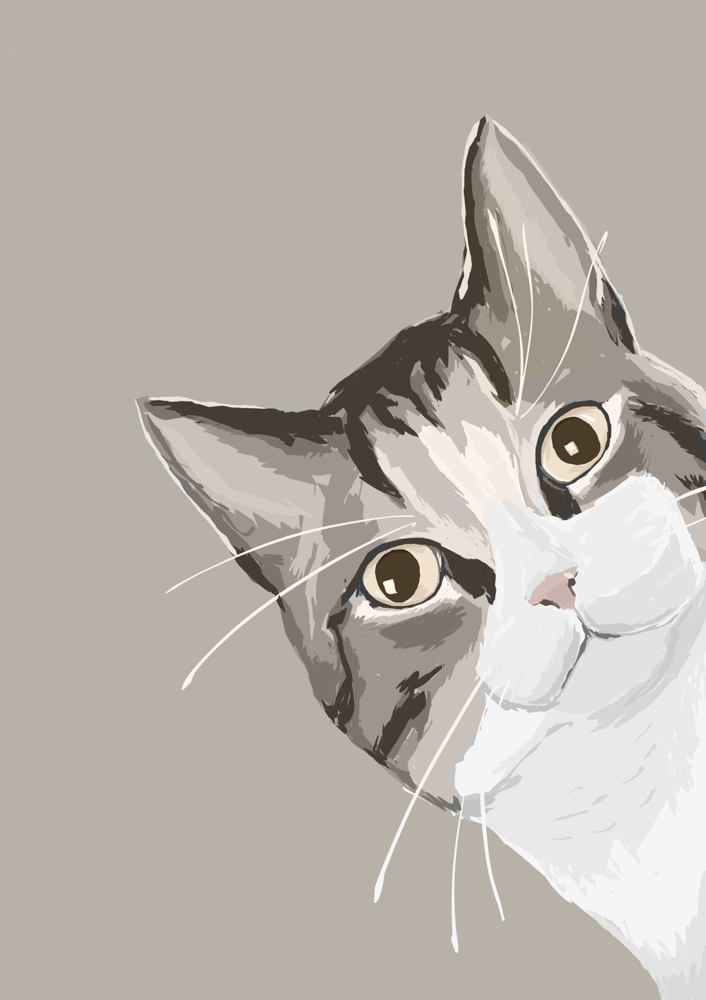

Sorry, not much to show this month but take a painting of our cat.

<!--more-->

I haven't spent much time on my game project this month but there have been plenty of other things going on. For instance, I've spent some time working on this small game project with a colleague which I might be able to show soon. And I've also spent plenty of hours just doodling on the ipad.

[Zig v0.17](https://ziglang.org/download/0.17.0/release-notes.html) was released so I've taken the time to migrage both the new small game project, and my own bigger project. This wasn't that much work this time and I was a bit slow this time so I think all my 3rd party dependencies were already migrated when I started.

I also did some maintenance of a 7 year old [repository for image registration](https://github.com/simeks/deform). A PhD student reached out and offered to freshen up the very dusty repository and I'm glad someone has found a use for it so I was happy to review! She did most of the work, I just reviewed and set up a github action for distributing it as a Python package.
